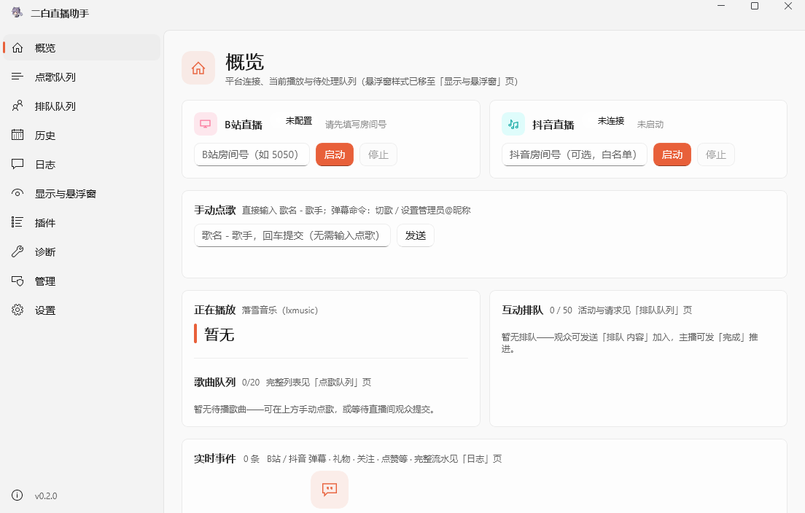

# ErbaiLiveTool（二白直播工具）

抖音 / B站直播弹幕驱动的点歌与互动工具。Windows 桌面应用（.NET 8 + WinAppSDK）。

<p align="center"></p>

## 功能

- **弹幕接入** — B站（WebSocket 协议 + 扫码登录）、抖音（系统代理抓包，内置抓包器宿主）
- **点歌互动** — 弹幕「点歌 / 切歌 / 设置管理员」全命令，搜索三源并发、队列治理、空闲歌单
- **互动玩法** — 弹幕排队、礼物插队与特效，全部可独立开关
- **悬浮窗** — 点歌队列 / 排队看板 / 弹幕栏三类独立悬浮窗 + OBS 浏览器源页面
- **第三方播放器插件** — 应用内按上游清单自动安装、校验签名并维护更新

## 平台支持

| 直播平台 | 接入方式 | 播放器 | 接入方式 |
| --- | --- | --- | --- |
| 抖音 | 系统代理抓包（内置） | 落雪音乐 | **原生支持**（Scheme / HTTP / SSE） |
| bilibili | WebSocket 协议 | 网易云 / 酷狗 / QQ 音乐 / Folia | [awoo-connectors](https://github.com/Enkianssus/awoo-connectors) 第三方插件（应用内自行安装） |

未安装播放器插件时，应用内「插件」页提供下载指引；落雪音乐随应用发布，无需安装。

## 快速开始

从 [Releases](https://github.com/f1shsmell/ErbaiLiveTool/releases) 下载（安装版 / 绿色版 zip，由 GitHub Actions 自动构建），或自行构建：

```bash
dotnet build ErbaiLiveTool.sln -c Release -p:Platform=x64
dotnet test  ErbaiLiveTool.sln -c Release -p:Platform=x64
powershell -ExecutionPolicy Bypass -File toolsuild-installer.ps1   # 安装包 + 绿色版
```

> `-p:Platform=x64` 不能省（App 工程锁定 x64）。安装包需要 Inno Setup 6。

## 文档

- [2026-10 变更记录](docs/changelog-2026-10.md) — 稳定性 / 交互 / 美化 / 布局 / 长稳 / 精简六轮明细
- [第三方组件对照](vendor/README.md) — vendored 二进制与上游对照

## 许可

[MIT](LICENSE)。本仓库当前代码树与全部历史均已排除未授权第三方表达（播放器连接器实现曾于早期提交内置，2026-10 已以 git 历史重写清除）；vendored 抖音抓包器源码遵循其原始 MIT 许可并随附原许可文件。使用时请遵守抖音、Bilibili 及各音乐平台的服务条款。
